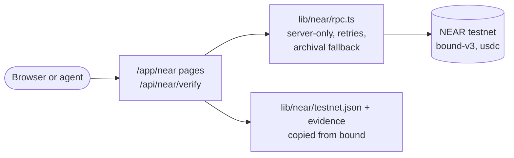

# bound-web

The marketing site and application for **Bound Protocol** — a surety bond for AI
agents on Stellar. An operator publishes a certificate carrying a _bound_ (the
maximum loss covered), funds its _reserve_, and a third-party _auditor_ stakes
slashable capital attesting to it. Anyone can verify a certificate, and anyone
can challenge one.

- `app/(landing)` — the marketing site
- `app/(app)` — the application, at `/app`
- Docs live in a separate deploy; `/docs` redirects there via `next.config.ts`

## Bound on NEAR testnet (NEAR HACKATHON)

**The bond-and-insurance layer for AI agents on NEAR.** You hire a contractor
because they are bonded and insured, not because you trust them personally.
Bound gives AI agents on NEAR the same thing: locked money behind the agent that
pays the people it harms, up to its cover.

Built at NEAR HACKATHON. Branch `near-hackathon` adds read-only pages for
**Bound on NEAR**: a counterparty checks, before dealing with an AI agent's
NEAR account, the cover behind it (the bond: a locked USDC reserve; the
insurance: an auditor's slashable stake), its spend meter, and whether the
agent's keys are confined to the contract's `pay`. It is a surety bond plus
staked cover, not a regulated insurance product. The contract, its tests, the demo and the main
submission README live in the `bound` repo, branch `near-hackathon`
([README](https://github.com/iamnotdou/bound/blob/near-hackathon/README.md),
[`near/README.md`](https://github.com/iamnotdou/bound/blob/near-hackathon/near/README.md)).
Only these NEAR pages are part of the submission from this repo; the rest of
the app is prior Stellar work.

- Tracks: `security` (primary), `agents`, `open`.
- Why NEAR: the agent's function-call access key (receiver `bound-v3`, method
  `pay`, no deposit) is enforced by the protocol itself, and these pages prove
  it from `view_access_key_list` plus `view_account.code_hash`. Accounts are
  named, so you verify `bound-agent2-mwfnc6q8.testnet`, not a hex address.
- Contract: [`bound-v3.boundproto-nh26.testnet`](https://testnet.nearblocks.io/address/bound-v3.boundproto-nh26.testnet)
  (code hash `A3yf1yzihbUdZAaHn92aAm5dBAdFCq1QCwhBJixD2B4H`), token
  [`usdc.boundproto-nh26.testnet`](https://testnet.nearblocks.io/address/usdc.boundproto-nh26.testnet)
  (mock USDC, play money). Recorded transactions: see the on-chain proof table
  in the `bound` README.
- Site: [near.boundprotocol.dev](https://near.boundprotocol.dev) (landing),
  [docs](https://near.boundprotocol.dev/docs),
  [deck](https://near.boundprotocol.dev/deck), built from this repo with
  `NEXT_PUBLIC_NEAR_ONLY=1 NEXT_PUBLIC_SITE_URL=https://near.boundprotocol.dev`.
- Live demo: [near.boundprotocol.dev/app/near](https://near.boundprotocol.dev/app/near),
  or run it locally as below. Screenshots of it are in the X post.
- npm: [`@bound/near`](https://www.npmjs.com/package/@bound/near) (published
  right after submission prep); MCP for agents:
  `{"command": "npx", "args": ["-y", "@bound/near", "mcp"]}`.
- Code written in the window:
  [`pre-hackathon...near-hackathon`](https://github.com/iamnotdou/bound-web/compare/pre-hackathon...near-hackathon)
  (also frozen as tag `hackathon-submission`). Contract side:
  [`bound` pre-hackathon...near-hackathon](https://github.com/iamnotdou/bound/compare/pre-hackathon...near-hackathon).

The pages need no wallet and no key: every figure is a view call or
access-key query the server makes to NEAR testnet over FastNEAR's JSON-RPC.

| Route                          | What it shows                                                                                                                                                                                                                           |
| ------------------------------ | --------------------------------------------------------------------------------------------------------------------------------------------------------------------------------------------------------------------------------------- |
| `/app/near`                    | verify an agent (deal or refuse, and why), every certificate on the contract, deployment check (on-chain `code_hash` equals the recorded build)                                                                                         |
| `/app/near/cert/<id>`          | coverage (reserve + auditor stake), spend meter, confinement proof (the agent's access keys AND its account code: code hash all ones, no global contract), claims, claim window countdown, settlement waterfall, participants' balances |
| `/app/near/run/<runId>`        | a committed `pnpm near:demo` run, each recorded transaction re-checked against an archival node                                                                                                                                         |
| `GET /api/near/verify/<agent>` | the same verdict as JSON for agents and services                                                                                                                                                                                        |

### Quickstart

From a clean clone (node 22, pnpm 10):

1. `git clone -b near-hackathon https://github.com/iamnotdou/bound-web && cd bound-web`
2. `pnpm install --frozen-lockfile`: exit 0.
3. `pnpm typecheck && pnpm lint && pnpm test && pnpm build`: exit 0, 146
   tests in 7 files; the build lists `/app/near`, `/app/near/cert/[certId]`,
   `/app/near/run/[runId]` and `/api/near/verify/[agent]` as dynamic.
4. `pnpm start`: ready on port 3000.
5. In a second terminal, `pnpm check:near http://localhost:3000`:
   `12/12 checks passed` (read-only, live testnet).
6. Open `http://localhost:3000/app/near`, verify
   `bound-agent2-mwfnc6q8.testnet` (deal, coverage 130, confined), then
   `/app/near/cert/0` (settled: victim paid 120 = 100 reserve + 20 slash) and
   `/app/near/run/mwfnc6q8` (`37 of 37` transactions match the chain).

### How it fits



### What was built during the hackathon

Code: `lib/near/` (deployment record and demo evidence copied from `bound`,
pure helpers with vitest coverage, server-only RPC reader),
`components/app/near/`, `app/(app)/app/near/`, `app/api/near/`,
`scripts/check-near.ts`, `scripts/sync-near.ts`. Outside those paths the
diff touches `components/app/app-header.tsx` (nav link), the landing page
(one link), `package.json` (scripts) and this section. The Stellar pages are
otherwise unchanged.

Libraries used: none added. The pages use Next.js, React and vitest, which
the app already had.

AI tools used: these NEAR pages were written by Claude Code (Anthropic) under
the author's direction.

Limitations: read-only (no wallet, no writes); testnet only with mock USDC;
demo runs `mwfgi0ij` and `mwfgqr0u` ran on the
superseded `bound-v1` contract and run `mwfiv11v` on the superseded
`bound-v2`, and all three are labeled as such; transactions older
than a few days are read from an archival node, and a rate-limited IP can see
"could not be fetched just now", which is labeled as no answer, not as a
mismatch. The trust model of the contract (author-held arbiter, treasury and
contract key) is described in the `bound` README.

## Development

This repo uses **pnpm**. There is one lockfile and it is `pnpm-lock.yaml`;
`package-lock.json` was deleted because it resolved `@stellar/stellar-sdk` to
13.3.0 while `@bound/sdk` requires `^16.0.1`, so the two lockfiles built
different, incompatible trees.

```bash
pnpm install
pnpm dev          # http://localhost:3000
pnpm typecheck    # tsc --noEmit
pnpm lint
pnpm test         # vitest, offline only
pnpm build
```

Copy `.env.example` to `.env.local` before running anything that signs.

## The application

| Route                | What it does                                                                                                                        |
| -------------------- | ----------------------------------------------------------------------------------------------------------------------------------- |
| `/app`               | Marketplace. Every certificate the registry holds, paginated via `?page=`, with search, status filter, hide-expired and only-mine.  |
| `/app/cert/[certId]` | One certificate: claimed vs live reserve, live auditor allocation, fund and attest controls, challenge control, and what it proves. |
| `/app/new`           | Wallet setup, then publish a certificate and fund its reserve in the same session.                                                  |
| `/app/auditor`       | Stake, see what is free, and attest certificates whose reserves are actually funded.                                                |

### The four legs

```
publish  →  fund reserve  →  auditor stakes  →  auditor attests  →  Verified
```

A stranger with a browser wallet and no testnet assets can walk all four in one
sitting: `/app/new` hands the wallet test XLM through friendbot, the wallet
signs its own USDC trustline, the faucet sends test USDC, and from there the
publish and fund steps are the wallet's own signatures. The last leg needs a
second party — either a wallet that has staked as an auditor, or
boundprotocol.dev's own demo auditor (see below).

### Claimed is not held

Publishing records a **claimed** reserve: a number on the certificate, with no
money behind it. `/app/cert/[certId]` reads `ReserveVault.get_balance` live and
shows both figures side by side, along with the shortfall. An auditor cannot
attest a certificate whose vault does not hold what it claims, and the gate says
so before anyone signs.

Everywhere in this app, an unreadable value renders as unreadable and never as
zero. "The vault says nothing" and "the vault says none" are different claims.

### How writes work

No secret key is involved in a wallet-signed action. The server builds an
unsigned envelope, **re-simulates it as assembled**, and returns it; the browser
wallet signs it in the extension; the server submits it.

The re-simulation matters. `AssembledTransaction.toXDR()` serialises whatever
was assembled, _including an assembly whose simulation failed_ — verified
against the deployed contracts, where attesting an unfunded certificate and
funding somebody else's reserve both produced well-formed, unsignable envelopes.
`assertSignableXdr` in `lib/tx.ts` is what refuses them.

`lib/bound.ts` is the only module that knows where certificate data comes from,
and `lib/tx.ts` is the only door to the write path. Both are server-only.

Certificates are listed **by certificate id, never by agent address**: an
agent's mapping names its _current_ certificate rather than all of them.

### The transaction journal

`/api/tx/submit` gives up polling after thirty seconds and used to report that
as "the network rejected the transaction" — for transactions that had landed.
The browser now computes the envelope's hash before submitting, writes it to
`lib/tx-journal.ts`, and re-reads every pending hash through `/api/tx/[hash]` on
mount. `NOT_FOUND` is a status, not a failure.

## The fiat boundary

`/app/fiat` is where value crosses between a bank account and Stellar, through a
SEP-24 anchor. It matters more than it looks: a surety bond whose collateral
cannot be funded from, or redeemed to, money people actually spend is not a
bond. This is the edge the protocol is only useful across.

| Step   | What happens                                                                                                                                                                                                                                                                                                                                                                                     |
| ------ | ------------------------------------------------------------------------------------------------------------------------------------------------------------------------------------------------------------------------------------------------------------------------------------------------------------------------------------------------------------------------------------------------ |
| SEP-1  | Every endpoint is read from the anchor's `stellar.toml`. Nothing is hardcoded — `ANCHOR_HOME_DOMAIN` names the anchor and `ANCHOR_ASSET_CODE` the asset, so pointing at a lira anchor is configuration rather than a diff. The toml also decides **which rail**: an anchor that publishes `TRANSFER_SERVER_SEP0024` is driven over SEP-24, one that publishes only `TRANSFER_SERVER` over SEP-6. |
| SEP-10 | The connected wallet signs the anchor's challenge, through the same Wallets Kit path every other write uses.                                                                                                                                                                                                                                                                                     |
| SEP-24 | An interactive deposit **or withdrawal** opens in the anchor's own hosted window. Both directions, because a reserve funded from fiat is half a rail if a proven claim cannot be paid back out.                                                                                                                                                                                                  |

### The challenge is verified before your wallet sees it

We ask you to sign a transaction fetched from a third party, so the server
proves it is genuinely a SEP-10 challenge first: sequence zero, sourced by the
`SIGNING_KEY` the anchor publishes, carrying the right home domain, already
signed by the anchor, and minted for _your_ account rather than someone else's.
Anything else is refused and never reaches a wallet — a signing prompt is the
last place that question should be settled.

One subtlety worth repeating, because it is silently wrong the other way:
SEP-10's `web_auth_domain` is the host of `WEB_AUTH_ENDPOINT`, **not** the home
domain. They coincide on the SDF reference anchor, so validating against the
home domain looks correct until you point at an anchor that serves auth
elsewhere, and then every challenge is rejected.

### Which money the reserve holds — two instances

The default deployment holds a self-issued test USDC while the anchor issues its
own, and they are different money: there, a completed deposit funds your wallet
and **cannot** fund a certificate's reserve. `GET /api/anchor` compares the two
issuers and returns `fundsReserve`; the panel leads with that, above the
controls, rather than letting a demo imply otherwise.

The second deployment closes that gap by being denominated in the anchor's own
USDC, so a reserve there holds money that crossed a fiat rail to get in.

| `NEXT_PUBLIC_STELLAR_NETWORK` | Reserves hold              | `fundsReserve` | Test money comes from |
| ----------------------------- | -------------------------- | -------------- | --------------------- |
| `testnet` (default)           | USDC the operator issues   | `false`        | `/api/faucet`         |
| `testnet-anchor`              | USDC **the anchor issues** | `true`         | a SEP-24 deposit      |

Both are live, and you can open either:

| Instance                                       | URL                                                            |
| ---------------------------------------------- | -------------------------------------------------------------- |
| Default — seeded certificates, faucet          | [www.boundprotocol.dev/app](https://www.boundprotocol.dev/app) |
| Anchor-denominated — a deposit funds a reserve | [bound-anchor.vercel.app](https://bound-anchor.vercel.app)     |

The second one is pointed at a Turkish lira ramp (`ANCHOR_HOME_DOMAIN=tr-mock-anchor.fly.dev`),
so `GET /api/anchor` there reports `"protocol":"sep6"` and `"fundsReserve":true`.

Neither replaces the other. The default is what
boundprotocol.dev serves: it carries the seeded certificates and a faucet that
can hand a visitor test money. On the anchor instance there is no faucet worth
the name — the anchor is where money comes from, which is the point of it, and
the amount in existence is whatever has been deposited.

Selecting one is two environment variables that must agree: `STELLAR_NETWORK`
for the server and `NEXT_PUBLIC_STELLAR_NETWORK` for the browser bundle.
`lib/bound.ts` compares the registry address the two halves resolved and throws
at build time if they differ, because a page that renders one deployment's
addresses beside another's figures is wrong in a way nobody would notice.

`pnpm check:anchor` prints the whole picture against the live anchor: the
discovered endpoints, the limits, a fetched-and-validated challenge, a tampered
one being refused, and the two issuers side by side. It signs nothing, moves
nothing, and is free to run.

## Server-signed endpoints

Two, and both hold keys that are worth only what they hold.

| Route         | Key              | What it does                                                                                            |
| ------------- | ---------------- | ------------------------------------------------------------------------------------------------------- |
| `/api/faucet` | `FAUCET_SECRET`  | Friendbots an address with no account; otherwise transfers test USDC from the faucet's **own** balance. |
| `/api/attest` | `AUDITOR_SECRET` | Signs `attest` as boundprotocol.dev's own auditor, for visitors who will not stand up a second wallet.  |

Neither is the USDC issuer and neither is the deployer. `OPERATOR_SECRET` — the
issuer key — is read by `scripts/setup-demo.ts` **and nothing else**, it runs
locally, and it must never be added to Vercel or to CI.

The faucet reads its own balance before it starts a transfer, so an empty faucet
says "the faucet is empty" rather than failing halfway. Its per-address cooldown
is in-memory, which on serverless resets per instance — the response says so
rather than implying a rate limit nothing here can enforce.

### The demo auditor

`accounts.auditor` in `@bound/sdk`'s committed deployment record is operated by
boundprotocol.dev. Its capital is real testnet stake and genuinely slashable,
but it is **not an independent third party**, and every place it appears as a
certificate's auditor carries a disclosure saying so — including the seeded
certificates it attested before this app existed. There is no badge.

## Setup and verification

```bash
pnpm setup:demo                      # local only; needs OPERATOR_SECRET + AUDITOR_SECRET
pnpm dev &
pnpm exec tsx scripts/check-reads.ts   # live reads vs the seeded fixtures
pnpm exec tsx scripts/check-gates.ts   # preconditions, against a dev server
pnpm exec tsx scripts/check-states.ts  # pagination, tx lookup, claimed vs live
pnpm e2e                               # the whole walk, on live testnet
```

`scripts/e2e.ts` generates two ephemeral keypairs per run and drives the app's
own HTTP routes, signing locally in place of the wallet extension. Every
assertion is a live chain read _after_ the fact, never a transaction's own
return value. `--through=usdc|fund|verified` stops early; `--base-url=` targets
a deployment.

It costs one new certificate on shared testnet, two throwaway accounts, and
about $20,000 of the faucet's test USDC per run. That is the intended price —
the registry is permissionless and the listing shows everything, including the
junk this leaves behind.

## Stack

Next.js 16 (App Router), React 19, Tailwind v4, shadcn, Outfit, primary `#FF5400`.

## The repositories

|                                                         |                                                                                      |
| ------------------------------------------------------- | ------------------------------------------------------------------------------------ |
| [`bound`](https://github.com/iamnotdou/bound)           | contracts, SDK, MCP connector, demo scripts                                          |
| [`bound-web`](https://github.com/iamnotdou/bound-web)   | the marketing site and the app at [boundprotocol.dev](https://www.boundprotocol.dev) |
| [`bound-docs`](https://github.com/iamnotdou/bound-docs) | the documentation site at [docs.boundprotocol.dev](https://docs.boundprotocol.dev)   |

Published packages: [`@bound/sdk`](https://www.npmjs.com/package/@bound/sdk) ·
[`@bound/mcp`](https://www.npmjs.com/package/@bound/mcp)

## License

MIT — see [LICENSE](./LICENSE).
